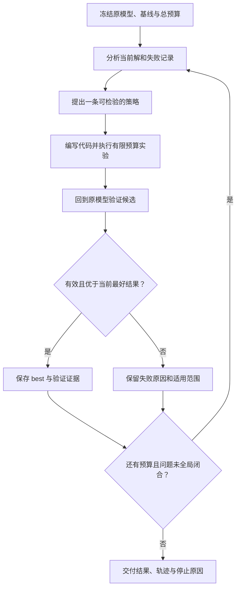
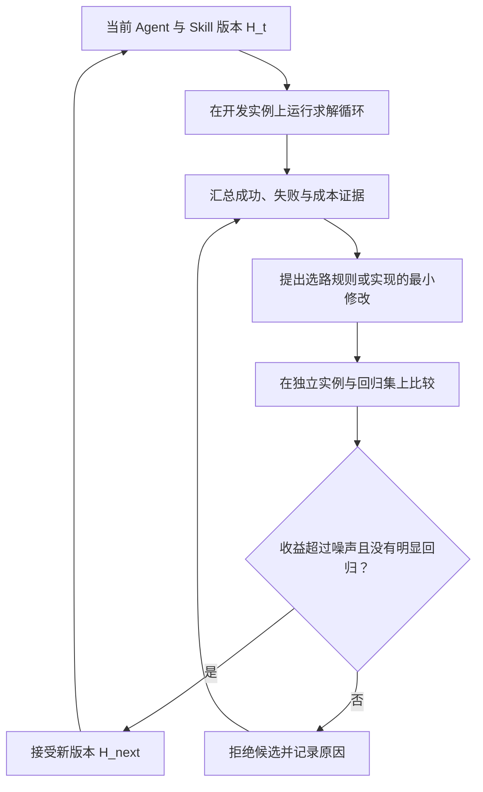

# RSI 实战：从 LLM4MIP 看求解策略如何逐步改进

让 Agent 调用一次求解器并不难。难的是求解停滞以后，它能否从日志中找到原因，换一种表示或搜索方法，把候选解放回原问题验证，并让这些经验帮助下一次求解。

上一篇讲怎样用 Eval 判断改动是否有效。这一篇把反馈落到运筹优化：以 [LLM4MIP](https://github.com/LLM4MIP/llm4mip.github.io) 的混合整数规划研究为案例，追踪从求解结果到下一轮策略的变化，再讨论怎样把经验变成可复用的 Agent 能力。

**先区分两件事：同一道题的解持续变好，以及求解这类题的方法持续变好。** 前者是优化搜索；后者才进入自我改进的讨论。要进一步称为递归自我改进，还需要新版本进入下一轮改进过程。

> 核验日期：2026-10-18。本文依据公开仓库、Skill 与历史案例解释机制，没有重新运行求解器。案例回放是对公开记录的教学组织，不代表完整恢复了原始 Agent 的决策过程。

## 一、RSI 到底改进什么

RSI 是 Recursive Self-Improvement，递归自我改进。这里采用一个可操作的判定：系统提出自身组件的修改，借助外部评估选择新版本，而被接受的新版本参与下一轮工作与改进。AIDE² 的研究就是让 Agent 修改自己的代码、比较候选，再将有效修改带入后续轮次。这里的改进可以发生在模型之外，不要求每轮训练权重。[研究来源](https://arxiv.org/abs/2609.26457)

在求解系统中，至少要分开三种状态：

| 状态 | 例子 | 判断改进的方式 |
|---|---|---|
| 当前解 `x` | 车辆路线、作业排程、设施选址 | 原问题可行性与目标值 |
| 求解方法 `p` | 邻域生成器、模型重构代码、修复算法 | 相同预算下的求解轨迹 |
| Agent 运行机制 `H` | Skill、选路规则、失败记忆、实验分配 | 新实例上的能力、成本与回归 |

这个区分可以直接用于阅读一次实验：

- 求解器继续搜索，得到更好的 `x`：说明求解取得进展。
- Agent 根据失败改写 `p`：说明它在做算法或策略研究；效果还需验证。
- 有效方法被整理成持久的 `H`，在新任务上验证：形成可复用的系统改进。
- 新 `H` 又参与后续候选生成与选择：才形成本文讨论的递归关系。

最后两步是本文建议补齐的工程设计，不能因为结果数字不断改善，就认定某个项目已自动完成了 RSI。

## 二、为什么运筹优化适合讲清这个过程

以最小化 MILP 为例，可以把原问题简写为：

```text
minimize    c^T x
subject to  A x <= b
            指定变量必须取整数，并满足各自上下界
```

现实模型还可能包含等式、目标常数、指示约束等。每次比较都必须保留原问题的这些语义，不能通过删约束得到一个看似更好的数值。

一个通过原问题检查的可行解给出上界 `P`；一个有效的全局松弛或证明给出下界 `D`。二者满足：

```text
D <= 最优目标值 <= P

Primal 改进：降低已验证的 P
Dual 改进：提高有效的全局 D
```

LLM4MIP 分别提供 primal 和 dual Skill：前者围绕构造、修复、邻域和 warm start 改善可行解；后者围绕有效松弛、割与分解改善全局界。它们不要求彼此先取得结果。[Primal Skill](https://github.com/LLM4MIP/llm4mip.github.io/blob/main/data/skill-study/packages/primal-current/SKILL.md) · [Dual Skill](https://github.com/LLM4MIP/llm4mip.github.io/blob/main/data/skill-study/packages/dual-current/SKILL.md)

因此，反馈能够落到具体问题：新方案是否可行？目标改善多少？是否只在局部子问题成立？把建模、失败尝试和验证也计入后，是否仍然值得？这比只让另一个模型评价“分析得很有道理”更容易检查。

## 三、LLM4MIP 中各个组件负责什么

公开仓库是研究网站与结果发布仓库，包含 Skill、辅助脚本和结果材料。它不是一个下载后就能一键重放全部研究的完整 Agent 控制器。实际求解还需要原始 MPS、相应代码、可用的求解器与许可证，以及验证环境。[仓库说明](https://github.com/LLM4MIP/llm4mip.github.io#readme)

可以把其方法拆成四个角色：

| 组件 | 承担的工作 | 主要产物 |
|---|---|---|
| LLM Agent | 分析结构、提出假设、编写实验代码、解释反馈 | 实验路线与代码 |
| Skill / 研究规则 | 约束选路、预算、记录和验证方式 | 可复用的执行规范 |
| 数学求解器与专用算法 | 执行数值搜索、解局部子问题、计算界 | 候选向量或界 |
| 验证工具 | 对齐原模型，检查候选与证据的有效范围 | 接受或拒绝的依据 |

例如，Agent 可以发现一组变量共同表达一条车辆路线，随后编写联合释放这些变量的代码；求解器负责完成搜索，验证器负责检查保存的向量。不能把数值搜索全归因于 LLM，也不能把求解器返回状态等同于独立验证。[方法依据](https://github.com/LLM4MIP/llm4mip.github.io/blob/main/data/skill-study/packages/primal-current/SKILL.md)

## 四、内层循环：让一道题逐步解得更好

下面概括的是公开 Skill 规定的求解工作流。它包含自适应策略，但本身还不证明跨任务自我改进。



### 1. 把基线固定下来

先记录模型哈希、目标方向、起始解来源、求解器版本，以及时间、线程和内存限制。没有可行解时，第一阶段目标是构造完整可行解；不能把未知值或无穷当成一个普通基线计算改善百分比。

### 2. 用结构假设驱动实验

“再跑一次”可以是基线，但一次有信息的实验应该回答具体问题：小邻域为什么改不动？哪些离散决策被错误地固定了？连续变量能否在离散决策确定后统一补全？

Primal Skill 要求每次试验记录观察、动作、必须保留的不变量、释放变量、补全方法、验证方法与切换条件。这样，无改进也能成为下一轮选路的证据。[执行规范](https://github.com/LLM4MIP/llm4mip.github.io/blob/main/data/skill-study/packages/primal-current/SKILL.md)

### 3. 把探索状态和最好结果分开

局部搜索有时需要先走向更差的探索状态，再进入新的区域。`current` 可以变化，`best` 只接受通过验证的更优候选。失败尝试不能覆盖最好解；新解出现后，也应重新检查哪些旧邻域结论仍然有效。

### 4. 验证持久化的实际结果

重新读取保存的解，在未修改的原模型上检查变量域、约束和目标值。固定整数后重新优化连续变量会生成一个新候选；把全部变量固定再检查，才是在核对原候选。两者不能混用。局部子问题得到 `OPTIMAL`，也不证明原问题全局最优。[验证与测量](https://github.com/LLM4MIP/llm4mip.github.io/blob/main/data/skill-study/packages/primal-current/references/validation-and-measurement.md)

## 五、两个案例：数字背后的下一步决策

### 案例 A：supportcase39，改变联合搜索的范围

公开案例记录：单点、双点以及较小窗口没有带来改善，之后采用更大的边界窗口联合调整，获得了更优目标。历史基线与结果如下；这是旧快照中的比较，不代表实时榜单。[案例材料](https://github.com/LLM4MIP/llm4mip.github.io/blob/main/data/skill-study/packages/primal-current/references/casebook.md)

| 观察项 | 记录或教学解释 |
|---|---|
| 历史目标值 | `-1085080.906934894` |
| 后续目标值 | `-1085083.856820570460`；最小化方向下更好 |
| 有效动作 | 使用 `11 × 11` 边界窗口，联合调整 30 个控制变量 |
| 可以提炼的假设 | 多个决策被约束耦合，较小的动作不能有效重排 |
| 尚不能推出的结论 | 所有实例都应该用同样窗口；该策略在同成本下普遍更强 |

适合写进经验库的是：当小动作被充分探索后，应按语义耦合关系扩大联合动作，再做预算受限的比较。窗口尺寸只是这个实例的记录，不能变成通用常量。

### 案例 B：ns1905797，先修可行性，再改善目标

公开记录给出的阶段轨迹是：

```text
构造完整可行点
    15.03429
        -> 14.62129
        -> 13.98258
        -> 后续延长运行未继续改善
```

这条轨迹包含构造、修复与后续求解，不是三次互相独立的盲测。案例还记录了把局部块解拼接后违反原问题约束的候选。它提醒我们：局部结果再好，也要先通过全局可行性检查，才能更新最好解。[案例与原始材料入口](https://github.com/LLM4MIP/llm4mip.github.io/blob/main/data/skill-study/packages/primal-current/references/casebook.md)

这两个案例分别适合解释“怎样改变搜索方法”和“怎样使用可靠反馈”。它们能够说明求解过程如何逐步推进，不能单独证明 Agent 已经递归升级了自己的通用能力。

## 六、外层循环：把一次经验变成下一版方法

要从上述求解流程走向 RSI，可以在内层之外增加一个可版本化的改进循环。下面是教学设计，公开仓库中的 frozen/current Skill 为讨论版本差异提供了材料，但目录里存在两个版本并不证明这些更新由 Agent 自动完成。



一个具体候选可以这样描述：

```yaml
# 教学示例，不是仓库中已有的实验记录
candidate: semantic-neighborhood-routing
parent: skill-v0
hypothesis: 多次停滞来自随机释放变量破坏了共同决策
change: 优先按车辆或时间窗生成邻域，保留小比例探索预算
frozen_components:
  - 原始模型与可行性检查器
  - 对照预算与结果计量方式
development: 用于提出规则的实例
validation: 未参与提议、且避免同源变体泄漏的实例
acceptance: 比较完整成本下的轨迹，并检查失败率与回归
```

**递归关系在于：被接受的规则帮助下一轮 Agent 提出和筛选改进。** 如果只是人工把案例写成 Skill，再交给固定 Agent 使用，应如实称为人工驱动的系统改进。若只在同一个实例上反复改脚本，应称为实例内的自适应求解研究。

## 七、怎样证明方法进步，而不只是算得更久

首先设置三个对照：直接求解器、固定 Agent 方法、允许更新的 Agent 方法。比较时固定实例、起点、模型、资源与总预算，并给固定方法同等预算的重试机会。下面是建议实验设计，不是对项目历史实验条件的描述。

| 维度 | 应记录什么 | 排除的混淆 |
|---|---|---|
| Primal | 首个可行解时间、已验证目标随时间的轨迹 | 只展示最后一次成功 |
| Dual | 有效全局界与证据等级随时间的轨迹 | 把局部界当全局界 |
| 完整成本 | 分析、代码生成、失败试验、加载、求解和验证 | 只计算求解器运行时间 |
| 稳定性 | 多次运行的分布与失败情况 | 把随机波动当能力提升 |
| 泛化 | 按实例族隔离的新任务表现 | 同源模型或历史答案泄漏 |
| 版本 | 父版本、Diff、实验结果和回退条件 | 无法知道哪条改动有效 |

LLM4MIP 明确区分完整研究与独立的 20 实例 Skill 对比，说明历史比较存在预算、版本或起点差异。Primal 与 dual 的组合结果也不能被解读为一次相同预算运行同时取得的两个端点。因此，引用它们时应描述固定基线上的观察，不声称已完成同成本因果验证。[对比口径](https://github.com/LLM4MIP/llm4mip.github.io/blob/main/downloads/primal-dual-source.md)

评估器还必须位于候选的修改范围之外。允许 Agent 改求解方法，不意味着允许它删原模型约束、放宽可行性标准或重写最终评分。数值可行性、全局数值界与独立数学证书，也要分别标注。

## 八、动手练习：先完成一轮可审查的策略改进

如果已经有求解器环境，先选一个有原始模型和验证手段的实例。不要以重现全部历史结果为第一步。

1. 冻结原始 MPS、起始解和资源预算，完成一次直接求解器基线。
2. 让 Agent 提出一个明确假设，只实现一条新路线。
3. 保存候选，回到原模型验证，画出目标或全局界的时间轨迹。
4. 把成功条件和失败范围写成一条候选规则，而不是只保存目标值。
5. 在未参与规则提议的实例上与旧版比较，决定保留或撤回。
6. 记录新规则是否参与下一轮候选产生；没有这一步，就暂不声称递归。

没有求解器或许可证时，也能先阅读 Skill、案例索引和对比口径，完成方法分析；这不等于实际复现。仓库的站点构建与结果一致性校验也不替代原始求解、解验证或证明重放。

## 小结

- 先标明被改进的是解、求解方法，还是 Agent 本身，避免把优化迭代直接等同于 RSI。
- LLM4MIP 的价值在于把结构分析、代码实验、数学计算和原问题验证连接起来。
- 失败也应改变下一步：记录范围、切换假设，保留最好结果。
- 可复用能力需要版本、独立评估与后续复用的证据；历史好成绩本身不够。

## 参考资料

- [LLM4MIP 仓库与研究说明](https://github.com/LLM4MIP/llm4mip.github.io)
- [Primal Skill 与配套案例](https://github.com/LLM4MIP/llm4mip.github.io/tree/main/data/skill-study/packages/primal-current)
- [Dual Skill 与全局界有效性规范](https://github.com/LLM4MIP/llm4mip.github.io/tree/main/data/skill-study/packages/dual-current)
- [独立 Skill 对比的来源与限制](https://github.com/LLM4MIP/llm4mip.github.io/blob/main/downloads/primal-dual-source.md)
- [Recursive self-improvement of AI research agents](https://arxiv.org/abs/2609.26457)

---

下一篇建议继续看：[Bot 类 Agent 实战：从 Grok Bot、Muse、Dot 到豆包工作](../07-cloud-bot-agents/index.html)
