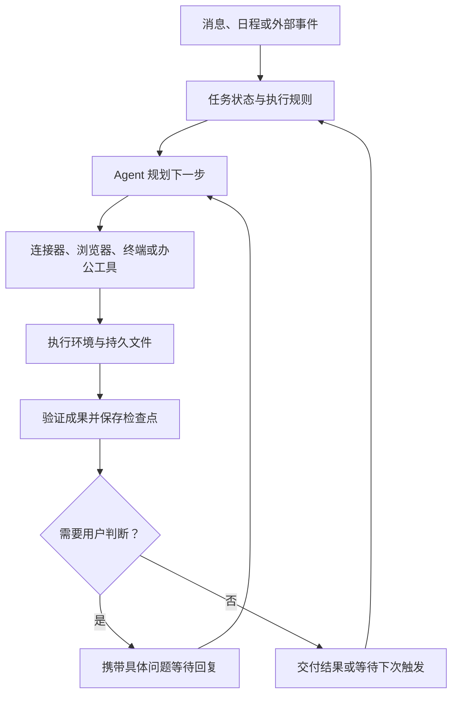

# Bot 类 Agent 实战：从 Grok Bot、Muse、Dot 到豆包工作

你把一项工作交给 AI，关闭电脑，第二天回来时，希望看到已经完成的报告、整理好的文件，以及等待你决定的问题。真正难的部分是：工作在哪里继续？它记得什么？遇到登录、重启或权限问题后，谁来接住？

Grok Bot、Meta Muse、ChatGPT 的 dot，以及豆包工作、扣子等产品，把这些问题从开发框架带进日常使用。本篇用同一项周期性工作解释怎样交代任务、观察执行和验收成果，再比较这些产品提供的运行条件。

> 产品说明核验于 2026-10-18。本文基于官方资料进行工程分析，提供可操作的测试方案；没有完成统一账号实测，不提供性能排名。开放地区、账号权益与界面以当前官方说明和账号页面为准。

## 一、先明确交给 Bot 的是什么工作

本篇把“Bot 类 Agent”作为一种工作方式：一个可持续联系的 Agent，承接有上下文的任务，在允许的环境里执行，并把成果和需要人判断的事项带回来。这是教学分类，各产品的内部架构与能力仍需分别确认。

先拿一个任务比较两种交代方式：

```text
一次性请求：
帮我看看这几个开源项目最近有什么变化。

持续工作：
接下来一周，每个工作日 09:00（Asia/Shanghai），
检查我指定的三个仓库的正式 Release。
与上次成功检查比较，保存变更清单、来源链接和检查时间。
没有更新也记录已检查；生成简报草稿，供我查看。
```

第二种任务增加了资料范围、触发时间、历史状态、交付格式和期限。能回答问题、执行一次长任务、跨会话接续，以及按计划自主启动，是需要分别验收的能力。

## 二、云端环境解决了什么

下面是理解持续任务的工程示意，表达共同设计问题，不代表任何一家产品公开了完全相同的实现。



使用时要区分三种环境：

| 环境 | 帮助完成什么 | 必须确认的条件 |
|---|---|---|
| 单次任务沙箱 | 在隔离环境中完成这一项任务 | 结束后保留哪些文件，何时回收 |
| 持久云电脑 | 跨任务复用文件、软件和部分会话状态 | 重启、进程退出和订阅结束后的恢复方式 |
| 用户本地电脑 | 使用本地文件、软件与已授权资源 | 本机是否开机，客户端是否运行 |

**云端执行、文件持久化、进程持续存活，是三个问题。** Manus 官方说明 Cloud Computer 可跨任务保留文件与工具，但机器重启、进程失败、资源限制和订阅变化仍可能中断工作。“关闭笔记本还能跑”不能解释为永不失败。[Manus 官方说明](https://www.manus.im/features/cloud-computer)

## 三、把产品放进同一张能力表

以下整理官方已说明的能力与需要检查的边界。“未据此确认”表示所引资料不足以建立结论，不代表产品一定不支持。

| 产品与资料 | 已说明的工作方式 | 使用前要核对的边界 |
|---|---|---|
| [Grok Bot](https://docs.x.ai/grok-bot/overview) | 命名 Bot、跨会话上下文、云电脑、计划与协作 | 同账号多个 Bot 共享电脑、文件和登录；角色不同不等于资源隔离 |
| [Meta Muse](https://about.fb.com/news/2026/09/introducing-muse-personal-ai-agent/) | 个人目标、主动推进，通过 App 或 WhatsApp 联系，使用专属 VM | 当前地区、接入应用及允许独立执行的动作 |
| [ChatGPT dot](https://help.openai.com/en/articles/20001530-getting-started-with-your-dot) | 云电脑、记忆、连接应用、持续工作和计划任务 | 本地访问需另行开启；本地任务依赖设备在线 |
| [豆包工作](https://www.feishu.cn/content/article/7677519271848610746) | 云端任务、周期调度、办公成果、飞书协作与工作伙伴 | 账号身份、企业权限和入口影响能力；长期 VM 生命周期需另查 |
| [扣子云电脑](https://docs.coze.cn/cozespace_device) | 为三方精选 Agent 提供持续在线的云端环境 | 套餐、资源规格与管理权限；设备重新分配可能清除数据 |
| [Manus Cloud Computer](https://www.manus.im/features/cloud-computer) | 可选择的持久电脑、跨任务文件与工具、脚本或 Bot 托管 | 机器在线和订阅有效仍是条件；需要处理失败与重启 |

### Grok Bot：多个角色可能共用一台电脑

官方文档说明：同账号的多个 Bot 使用同一台云电脑，共享文件、浏览器会话和应用登录。实践中应分配工作目录、任务归属与写入责任，再观察交接能否正常完成。不能因为创建了“研究员”和“编辑”，就推断它们已获得独立的数据权限。[共享电脑说明](https://docs.x.ai/grok-bot/overview)

### Muse 与 dot：长期目标需要可检查的阶段

Muse 的介绍强调围绕个人目标主动推进，运行于容纳 Agent 与用户数据的专属 VM；dot 的说明强调在对话之间继续工作，使用连接的应用和自己的云电脑。可以用它们观察长期目标怎样转化为阶段产物、待办和后续行动。[Muse](https://about.fb.com/news/2026/09/introducing-muse-personal-ai-agent/) · [dot](https://help.openai.com/en/articles/20001530-getting-started-with-your-dot)

这里将常说的“GPT Dot”写作 ChatGPT 的 dot。dot 的本地电脑访问需要另行开启，并依赖本机在线；手机可以联系 Agent，并不代表远程处理本地文件时可以关闭电脑。[本地访问说明](https://help.openai.com/en/articles/20001530-getting-started-with-your-dot)

### 豆包工作：办公成果可以继续进入团队协作

用户常说的“豆包办公”，本文对应官方产品名“豆包工作”。官方资料说明它可处理研究、文档、表格、演示等任务，支持云端周期执行、飞书协作和工作伙伴。产品入口、伙伴角色与企业权限需要分别理解。[官方产品介绍](https://www.feishu.cn/content/article/7677519271848610746)

一个合适的练习是：基于有权限的项目材料生成复盘文档，检查事实和数字，再把成果交给团队编辑。验收时分别记录个人账号与企业账号的数据范围、成果所在空间，以及不同入口提供的能力。资料能够支持云端任务执行的描述，但不足以据此认定每位用户都有生命周期相同的长期 VM。

### 扣子与 Manus：先确认选中的执行环境

扣子的云电脑说明针对三方精选 Agent 的持续在线环境；创建对话型智能体与配置云电脑是不同的问题。Manus 则说明可以选择同一台 Cloud Computer，在后续任务中继续使用文件和工具。比较时应记录所选 Agent 与设备，避免把不同运行环境的结果混在一起。[扣子](https://docs.coze.cn/cozespace_device) · [Manus](https://www.manus.im/features/cloud-computer)

## 四、动手交付一项持续任务

继续使用三个公开仓库的 Release 简报。它的验收对象明确，能暴露时间设置、来源、去重和接续问题。下面是任务模板，不是各产品通用的配置接口。

```text
任务：维护三个仓库的 Release 简报。
范围：仅访问我提供的三个官方仓库链接。
触发：工作日 09:00，时区 Asia/Shanghai。
期限：首次成功试跑后运行一周，到期暂停并提交总结。
初次运行：建立正式版本基线，说明是否包含预发布版。
后续运行：只报告基线之后的新正式版本；没有更新也留记录。
交付：来源链接、版本号、发布时间、检查时间、主要变化及草稿。
权限：读取公开资料，写入指定目录，只交付草稿。
异常：报告失败来源，保留上次成功状态；访问失败不写成无更新。
恢复：再次运行时按仓库与 Release ID 去重。
预算：使用账号允许设置的额度与执行限制，到达限制后告知我。
```

如果产品不能设置期限、预算或状态存储，就记录缺口，使用可用的暂停方式或外部存储补齐。对话中表示同意，不等于实际配置成功。

### 第一步：确认地点与访问能力

让 Agent 说明任务使用云端还是本地环境，成果保存在哪里，从何处查看状态。对需要登录的任务，区分连接器账号与云浏览器会话。dot 的故障排查说明，本地浏览器登录不会自动传到云端浏览器。[环境与登录说明](https://help.openai.com/en/articles/20001530-getting-started-with-your-dot)

### 第二步：手动跑通一次

检查三项证据：访问了规定来源；版本号与日期和来源相符；指定位置存在实际产物。先修正字段、时间和路径，再开启周期执行。

对比产品时保持输入、提示和验收要求一致。如果缺少对应能力，就记录不支持或待确认，不要改变任务后继续给出可直接比较的分数。

### 第三步：保存能够接续的状态

“记得我喜欢简洁风格”与“知道上次成功检查了哪个版本”是不同的状态。建议将后者保存在可检查的文件或任务记录中：

```json
{
  "task_id": "release-digest",
  "timezone": "Asia/Shanghai",
  "repositories": {
    "owner/example": {
      "last_success_at": "2026-10-19T01:00:00Z",
      "last_release_id": "example-release-id"
    }
  },
  "output_directory": "release-digest/"
}
```

这是教学示例，不是实际运行记录。正式任务应保存真实时间和 ID。执行成功并保存产物后才推进相应检查点；来源失败则保留上次成功状态，让下一次能够补查。

### 第四步：验证离开后的执行与恢复

确认任务使用云端后，关闭本地客户端，等下一次触发，再从可用入口核对运行历史与产物。重启恢复只在可恢复的测试任务中验证，并提前保存状态。记录中断后实际发生的行为，不从“支持云电脑”推断自动重试和去重一定正确。

## 五、怎样判断是否值得长期交付

连续观察同一个任务一周，可以发现单次演示看不到的问题。下面是建议记录的维度，没有填入未经测试的成绩。

| 维度 | 观察方法 | 合格结果应是什么 |
|---|---|---|
| 初次设置 | 记录连接、配置和人工修正用时 | 知道任务在哪里运行 |
| 计划执行 | 对照计划与实际运行历史 | 时区正确，漏跑可发现 |
| 结果准确性 | 抽查版本、日期和来源 | 结论能够回到来源核验 |
| 接续与去重 | 再运行同一时间段 | 不重复处理已完成条目 |
| 异常反馈 | 使用一个无效测试来源 | 报告失败，不编造无更新 |
| 人工介入 | 记录修复、登录和决策次数 | 每次接管有具体原因与上下文 |
| 完整成本 | 记录模型、云设备和服务费用 | 能解释一次有效交付的成本 |
| 退出与迁移 | 导出成果、暂停计划、检查后续记录 | 成果可取回，计划确实停止 |

模型用量并不代表全部费用，持续在线的产品描述也不能代替可用性测试。没有统一实测，就不应从这张表生成“最强 Bot”排名。

## 六、最容易混淆的四个边界

**连接成功与动作授权。** 能读取资料，不代表可以向外发送或修改记录。开始时明确成果与动作范围，让 Agent 带着实际产物进入需要人判断的步骤。

**角色数量与资源隔离。** 多个 Bot 可能共享文件、账号和浏览器；至少 Grok Bot 官方文档明确如此。角色分工需要配合实际资源边界。[来源](https://docs.x.ai/grok-bot/overview)

**暂停、断开连接与删除记忆。** 这些操作不一定效果相同。dot 官方说明，断开应用不会自动删除此前取得的信息。退出时应查看产品对应的导出、暂停和删除说明。[来源](https://help.openai.com/en/articles/20001530-getting-started-with-your-dot)

**记住经验与 RSI。** 保存偏好、沿用工作方法，可以改善体验；若要称为递归自我改进，仍需上一篇讨论的版本变化、独立评估和后续复用证据。持续运行提供了积累经验的条件。

## 小结

- 把 Bot 当作有目标、期限、状态和产物的一项工作来验收。
- 云端任务、持久电脑与本地电脑的生命周期不同，先确认执行地点。
- Grok Bot、Muse、dot、豆包工作、扣子和 Manus 可以按相同维度考察，能力仍须分别核对。
- 先跑通一次，再验证计划触发、异常恢复和停止行为，最后讨论长期交付。

## 参考资料

- [Grok Bot 官方概览](https://docs.x.ai/grok-bot/overview)
- [Meta Muse 官方介绍](https://about.fb.com/news/2026/09/introducing-muse-personal-ai-agent/)
- [ChatGPT dot 官方入门与控制说明](https://help.openai.com/en/articles/20001530-getting-started-with-your-dot)
- [豆包工作官方产品介绍](https://www.feishu.cn/content/article/7677519271848610746)
- [豆包工作伙伴官方说明](https://aily.feishu.cn/hc/1u7kleqg_3d5z9ttt?_lang=zh)
- [扣子云电脑官方说明](https://docs.coze.cn/cozespace_device)
- [Manus Cloud Computer 官方说明](https://www.manus.im/features/cloud-computer)

---

下一篇建议继续看：[返回应用实战目录，选择下一项实践](../index.html)
